# Ek Baithak.

**Get a small business online in one sitting.** Ek Baithak ("one sitting") is a digital-first journey for Accel Business. A shop, clinic or factory owner picks the right bundle, buys it and gets it activated on their phone, in Hindi or English, with little or no human effort.

> Airtel **SYNC** · YTL Hackathon 2026 · **Enterprise Track A: Project Udyam Digital**
> Team **Jagh** · Jiya · Hera Siddique
>
> **Live demo:** https://jiyare06.github.io/ek-baithak/ · **Repo:** https://github.com/Jiyare06/ek-baithak
> **Demo video (2:18):** [docs/demo/ek-baithak-demo.mp4](docs/demo/ek-baithak-demo.mp4)

All businesses, people, identifiers and documents in this repo are **synthetic**. They come from the hackathon data pack and describe no real company or customer. Accel Telecom and Accel Business are the fictional operator used in the case.

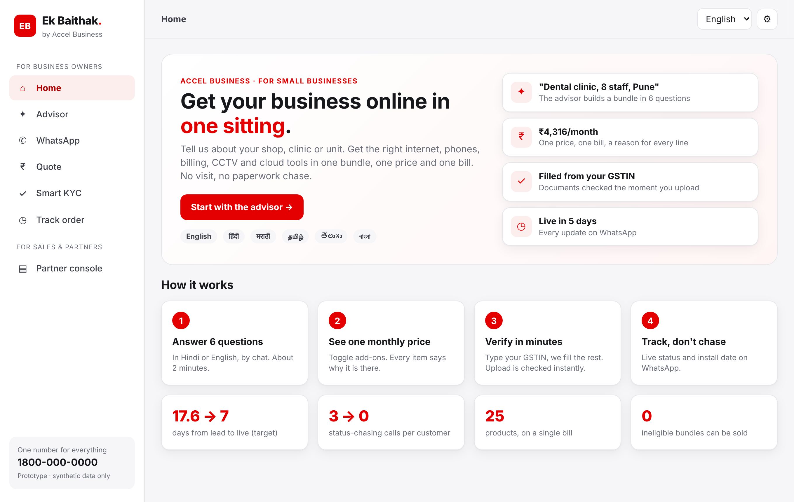

---

## The problem, in one line

Only **7.4%** of SMB leads (368 of 5,000) become customers. It takes **17.6 days** and **3 status-chasing calls**, and costs **₹15,054** to acquire each one. Most leads are lost to visits that never happen, slow or confusing quotes and paperwork, not to a lack of demand. (`python analysis/funnel_analysis.py` reproduces every number.)

## What we built

The prototype covers all four parts of the build challenge, plus two stretch goals.

| Build challenge | What it does in Ek Baithak | Where |
|---|---|---|
| **Advisor** (GenAI) | Chat in English or हिंदी. Asks 6 questions (type, size, sites, city, current internet, needs, GSTIN) or understands free text such as *"dental clinic, 8 staff, Pune"*. A deterministic rules engine picks products. An LLM explains the bundle in plain language but **cannot change products or prices**. | `frontend/js/views/advisor.js`, `frontend/js/engine.js` |
| **Quote & checkout** | One monthly price. Add-ons toggle on and off, quantities change, and setup fees can be spread over the bills. Ineligible products are shown greyed out with the reason ("needs 10+ employees", "needs an active GSTIN"). | `frontend/js/views/quote.js` |
| **Smart KYC** | A consent screen per purpose (DPDP), then a mock GSTIN/Udyam lookup. Documents are uploaded and **OCR'd in the browser**, and each one gets blur, tilt, checksum, registry status, name-match, 90-day address-proof and ID-expiry checks. DigiLocker and Aadhaar e-Sign are mocked. | `frontend/js/kyc.js`, `frontend/js/views/kyc.js` |
| **Tracker** | Order timeline with dates calculated from catalogue install days, technician slot booking and WhatsApp-style status pushes, so the owner never has to call. | `frontend/js/views/tracker.js` |
| Stretch: **WhatsApp + voice** | The same advisor in a WhatsApp-style chat (quick-reply buttons, verified business header), as it would run on the WhatsApp Business API. Owners can **answer by voice** (🎙, Web Speech API, `hi-IN` / `en-IN`) and **hear replies** (🔈). Simulated WhatsApp in the prototype. | `#whatsapp` route, `frontend/js/views/advisor.js` |
| **Advice that re-checks itself** | If the GSTIN turns out Cancelled or Suspended, at the advisor or at KYC, the rules engine removes GST-only products from the quote and says which ones. | `frontend/js/views/kyc.js`, `quote.js` |
| Stretch: **back office** | A partner and sales console listing the leads the journey could not close, ranked by score, each with a "why" and a next best action. | `frontend/js/views/console.js` |
| Stretch: **propensity score** | Logistic regression trained on `smb_leads.csv` (hold-out AUC **0.74**). | `analysis/build_data.py` |

### Product walkthrough (phone)

| WhatsApp (हिंदी) | Advisor | Recommendation | Quote | Smart KYC | Tracker |
|---|---|---|---|---|---|
| 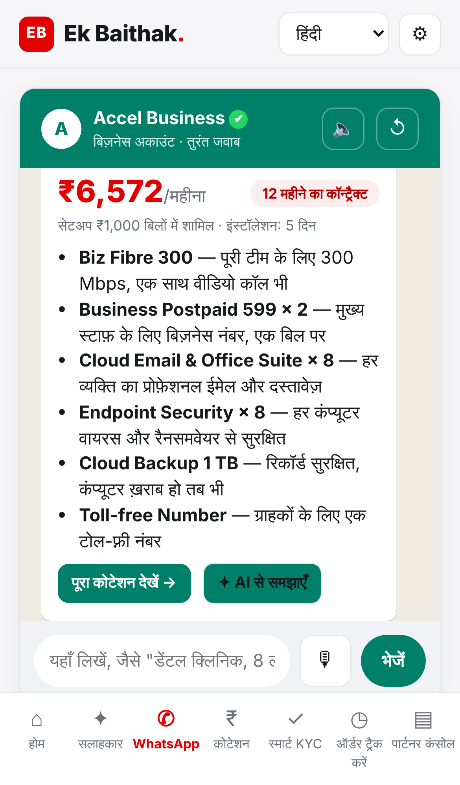 | 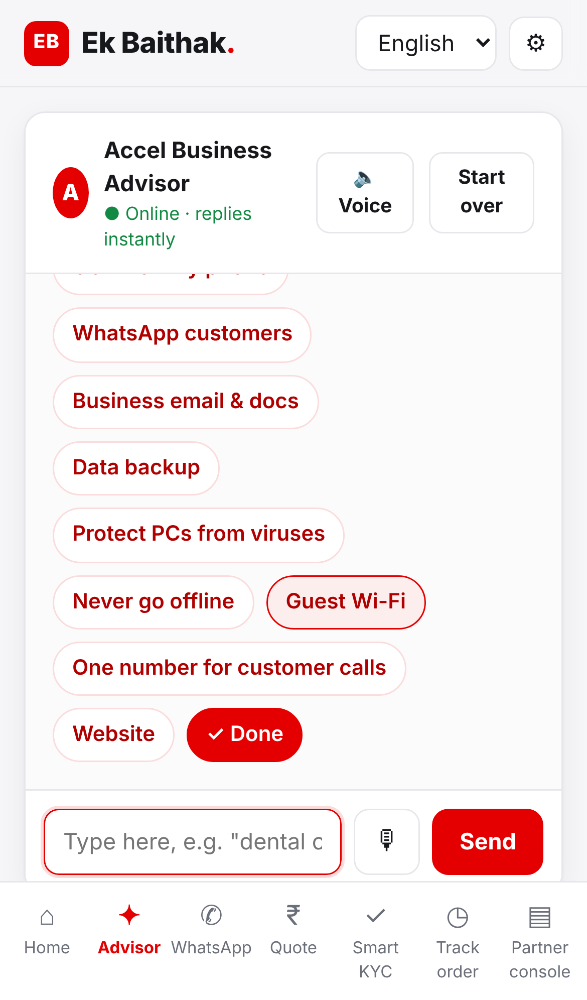 | 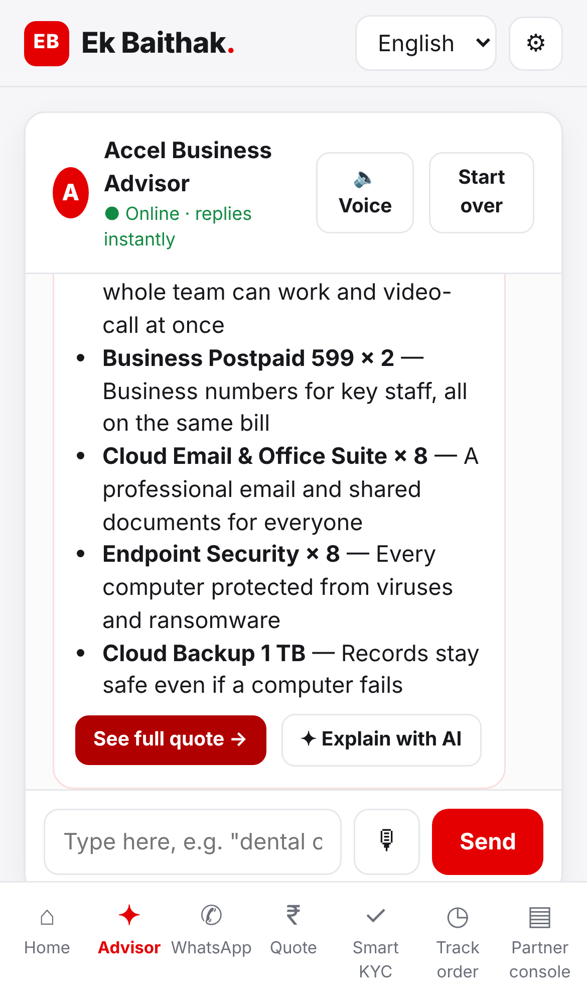 | 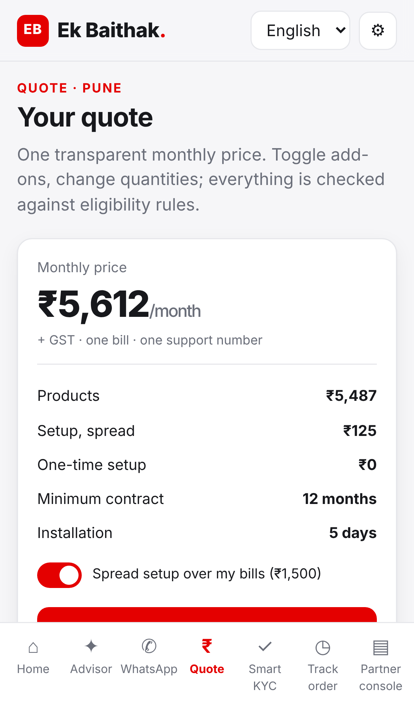 | 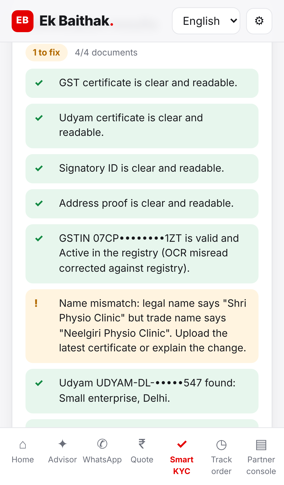 | 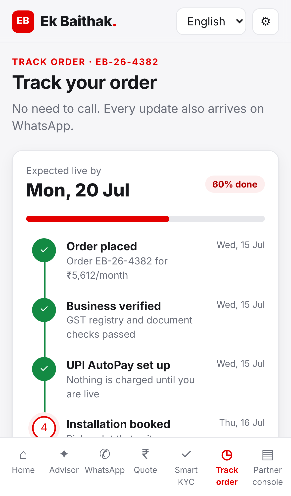 |

### Desktop screens

| Advisor | Quote |
|---|---|
| 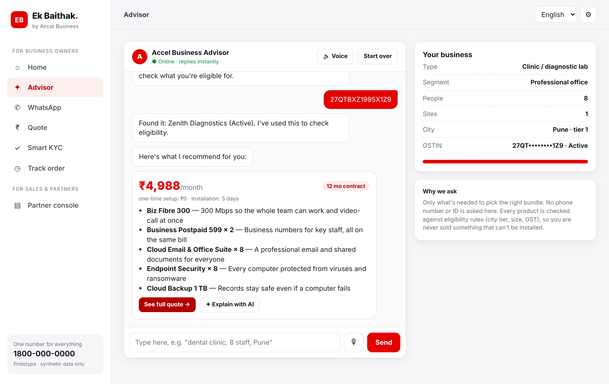 | 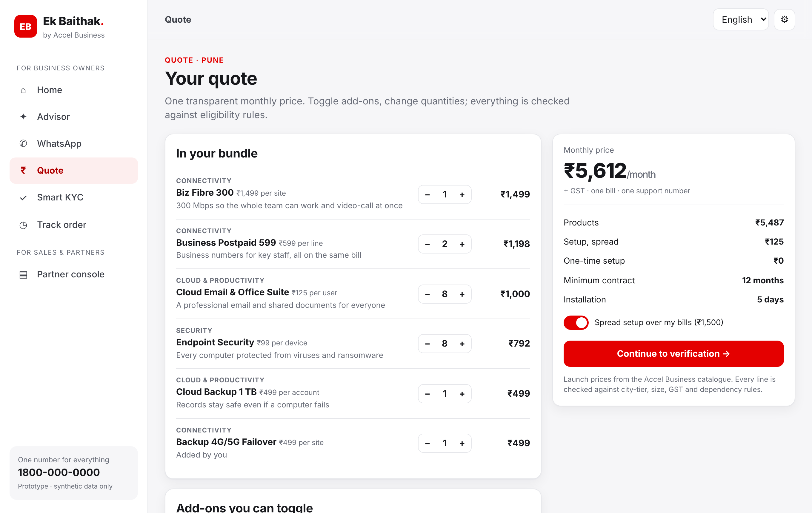 |
| **Smart KYC: a name mismatch caught** | **Tracker** |
| 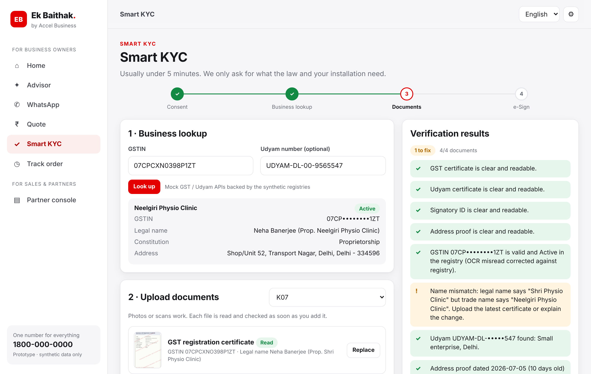 | 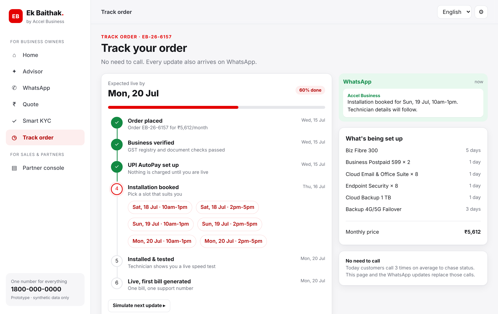 |
| **Partner console** | **Consent** |
| 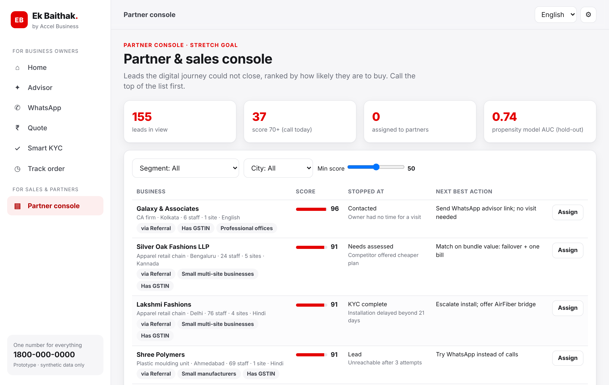 | 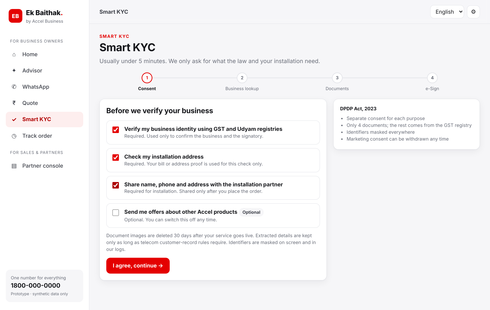 |

## Smart KYC on the 12 specimen applicants

`python analysis/kyc_validator.py` runs the same rules as the browser. It flags 7 of the 12 applicants: 1 problem is fixed automatically and 6 need the customer to act.

| Applicant | Finding | What the owner is told |
|---|---|---|
| K01 | GSTIN is **Cancelled** in the registry; Udyam certificate has no number | GST-only products are removed; upload the full Udyam certificate |
| K02 | GST certificate scanned **tilted ~7°** | Straightened automatically, then read (no action needed) |
| K04 | GST certificate **blurred** | Retake in good light |
| K05 | **Udyam certificate missing** | Upload it |
| K06 | GSTIN **fails the checksum** (a digit was altered) | Blocked |
| K07 | **Name mismatch** between the legal name and the trade name | Upload the latest certificate or explain the change |
| K11 | Address proof is **257 days old** | Upload a bill from the last 90 days |
| K03, K08, K09, K10, K12 | Clean. OCR misreads (O/0, I/J) are corrected against the registry. | — |

On top of these, a **cross-document check** blocks any upload where the GST certificate, Udyam certificate, bill and signatory ID belong to different businesses.

## How it decides: rules vs AI

```
Owner's answers ─► Rules engine ─► bundle + prices (auditable, never mis-sold)
                         │
                         └─► LLM ─► plain-language "why" in the owner's language
```

* **The rules engine decides.** City tier, minimum employees and sites, active GSTIN and product dependencies all come from `product_catalogue.csv`. In the historical data, 56 of 368 activations (15%) broke one of these rules; this engine cannot do that.
* **The LLM only explains.** Open ⚙ to add an API key and **Explain with AI** rewrites the explanation. Without a key, the app uses built-in English and Hindi explanations, so the demo works offline.

## Architecture

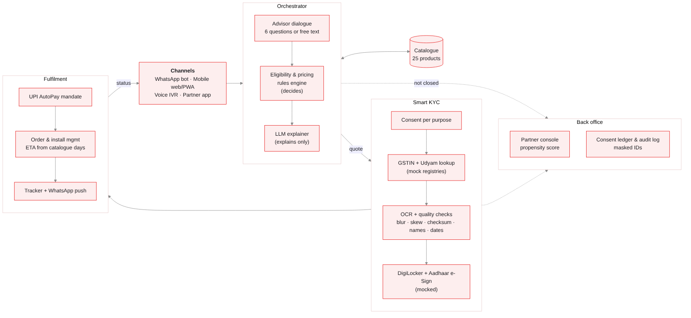

The Mermaid source is in [`docs/architecture.mmd`](docs/architecture.mmd). The prototype runs entirely in the browser: the registries are JSON files standing in for the GSTIN and Udyam APIs, and OCR runs locally with vendored [tesseract.js](https://github.com/naptha/tesseract.js), so **no document image leaves the device**.

## Run it

```bash
git clone https://github.com/Jiyare06/ek-baithak.git
cd ek-baithak/frontend
python3 -m http.server 8000      # any static server works
# open http://localhost:8000
```

There is no build step and nothing to install for the frontend. To regenerate the data and models:

```bash
pip install -r requirements.txt          # pandas, numpy, scikit-learn, pillow
python analysis/build_data.py            # CSV -> frontend/data/*.json, trains propensity model
python analysis/kyc_validator.py --cache # needs the tesseract binary; refreshes specimen OCR cache
python analysis/funnel_analysis.py       # prints every number used in the deck
node tests/engine.test.mjs               # every recommended bundle passes every eligibility rule
```

**Demo tips:** in Smart KYC, the *Demo: load specimen applicant* dropdown loads K01–K12. In the advisor, two demo GSTIN chips use an Active and a Cancelled GSTIN from the mock registry, so you can watch the advice change. Voice input needs Chrome or Edge and microphone permission. *Simulate next update* on the tracker moves the order forward.

**GitHub Pages:** push to `main`. The workflow in `.github/workflows/pages.yml` publishes `frontend/` (set Pages → Source: *GitHub Actions*).

## Repo map

```
frontend/                static app (deployable as-is)
  index.html, css/, js/  engine.js (rules) · kyc.js (validators, OCR) · views/*
  data/                  catalogue, mock registries, propensity model, specimen OCR cache
  specimens/             the 47 synthetic KYC images (K01–K12)
  vendor/tesseract/      tesseract.js + English model, Apache-2.0
analysis/                build_data.py · kyc_validator.py · funnel_analysis.py
data/                    the synthetic hackathon CSVs + their README
tests/                   rules-engine test (no mis-sold bundles)
docs/                    architecture, privacy note, business case, screenshots
```

## Submission checklist (from the case)

- [x] Working prototype: this repo, with a 2:18 demo video in [`docs/demo/`](docs/demo/ek-baithak-demo.mp4)
- [x] Solution architecture diagram: `docs/architecture.png`
- [x] Business case: `docs/BUSINESS_CASE.md` and the 7-slide deck
- [x] 1-page data privacy and security note: [`docs/PRIVACY.md`](docs/PRIVACY.md)

## Team Jagh

Jiya · Hera Siddique

*Ek Baithak. Dukaan se digital, ek hi baithak mein.* ("From shop to digital, in a single sitting.")
